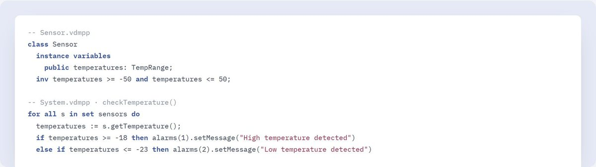
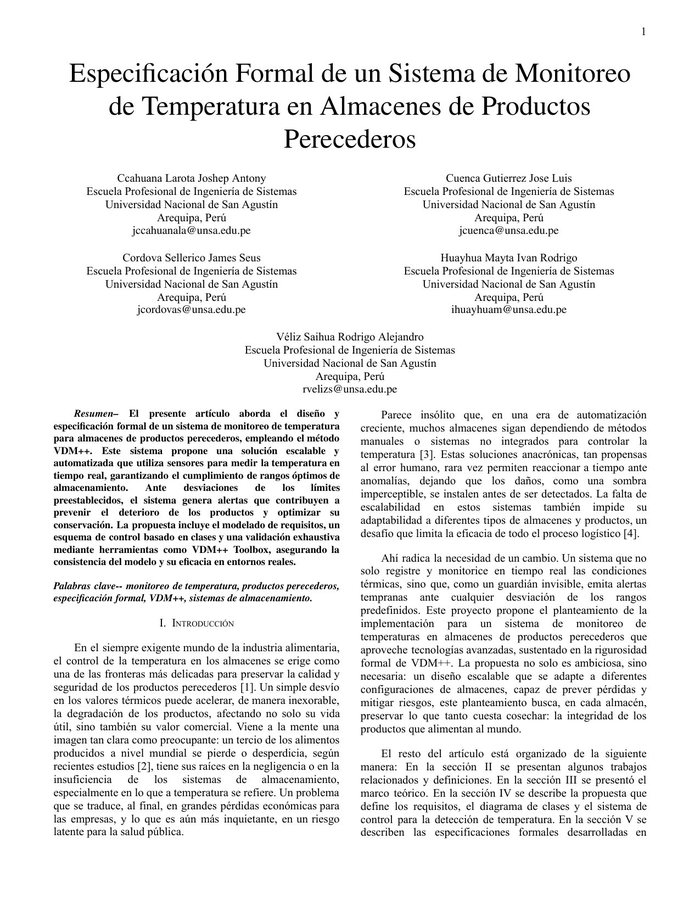
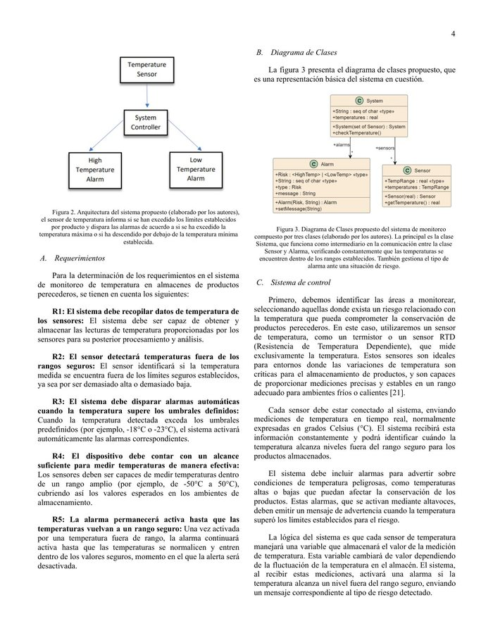

# Monitoreo de temperatura en VDM++

Especificación formal de un sistema que vigila la temperatura de almacenes de productos congelados y activa una alarma cuando la lectura sale del rango seguro. Está escrita en VDM++ y validada con VDM Toolbox.

Fue el primer proyecto de un curso de la UNSA (noviembre de 2024) y terminó en un artículo grupal. Yo escribí la especificación y la validación.

## El modelo

Hay tres clases. `Sensor` guarda la lectura, con la invariante de que siempre está entre −50 y 50 °C. `Alarm` tiene un tipo de riesgo (`<HighTemp>` o `<LowTemp>`) y un mensaje que nunca puede quedar vacío. `System` revisa todos los sensores: activa la alarma de alta temperatura desde −18 °C y la de baja desde −23 °C, y cuando la lectura vuelve al rango deja las dos alarmas en `"none"`.

`Test.vdmpp` tiene los casos de prueba y `test.tc` es el archivo de cobertura que genera VDM Toolbox al ejecutarlos. El diagrama de clases está en `PROYECTO.puml` (PlantUML).

## El artículo

El PDF completo está en el repositorio. Ahí se explican los cinco requisitos formalizados, la arquitectura y el diagrama de clases.

## Ejecutarlo

Se abren los archivos `.vdmpp` en VDM Toolbox (o en Overture), se cargan las cuatro clases y se ejecutan las operaciones de `Test`.
